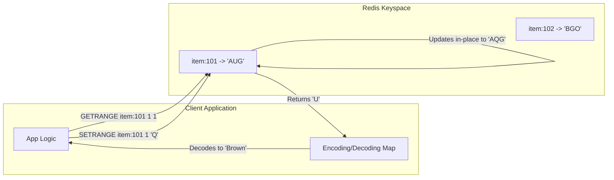

---

tags:

* redis
* data-modeling
* string-encoding
* performance-optimization
* interview-prep
aliases:
* Redis Fixed-Width String Packing
* High-Performance String Slicing Pattern
date: 2026-10-04
module: "Redis Strings - Real-World Modeling with Slicing & Batching"

---

## 1. Overview

* Traditional relational databases (RDBMS) often experience severe I/O bottlenecks when high-concurrency systems frequently read and update small subsets of entity attributes across massive catalogs.
* While commands like `GETRANGE` and `SETRANGE` may seem obscure for general string handling, they enable **positional fixed-width string encoding**.
* By mapping repetitive low-cardinality attributes to single-byte codes and packing them into a single continuous string, Redis can execute sub-millisecond property lookups and partial updates with minimal memory overhead.

---

## 2. Key Concepts

* **Positional Encoding**: Storing multiple distinct attributes inside a single string value at fixed byte offsets rather than creating separate keys or complex nested objects.
* **Low-Cardinality Enumeration**: Replacing verbose text strings (e.g., `"brown"`, `"leather"`) with compact single-character or single-byte identifiers (e.g., `'E'`, `'O'`) when the total set of possible values is small and bounded.
* **In-Place Mutation**: Using `SETRANGE` to modify a single attribute directly in Redis memory without fetching the record, modifying it in the application tier, and writing the entire string back.
* **Bulk Vector Operations**: Using `MGET` and `MSET` alongside packed representations to hydrate or mutate multiple entities in a single network round trip (RTT).

---

## 3. How It Works

### 1. Attribute Mapping & Encoding Scheme

Consider an inventory catalog with three low-cardinality properties per product: `Type`, `Color`, and `Material`.

| Attribute | Offset | Possible Values | Mapping Example |
| --- | --- | --- | --- |
| **Type** | Index `0` (1 byte) | Couch, Table, Chair, Desk... | `A` = Couch, `B` = Table, `C` = Chair |
| **Color** | Index `1` (1 byte) | Red, Green, Blue, Brown, Black... | `U` = Brown, `Q` = Red, `C` = Blue |
| **Material** | Index `2` (1 byte) | Wood, Leather, Plastic, Metal... | `G` = Wood, `O` = Leather, `P` = Plastic |

### 2. In-Memory Memory Layout

Instead of storing structured JSON (`{"type":"couch","color":"brown","material":"wood"}`) which consumes dozens of bytes of syntax metadata, Redis stores a 3-byte payload:

```
Key: item:101
Value: "AUG"

Byte Offset:    [ 0 ]     [ 1 ]     [ 2 ]
Character:      [ A ]     [ U ]     [ G ]
Attribute:      Type      Color    Material
Meaning:        Couch     Brown     Wood

```



### 3. Mapping Access Patterns to Redis Commands

1. **Fetch specific property of an item**: Call `GETRANGE item:<id> <offset> <offset>`.
2. **Fetch all properties of an item**: Call `GET item:<id>` or `GETRANGE item:<id> 0 2`.
3. **Update specific property of an item**: Call `SETRANGE item:<id> <offset> <new_char>`.
4. **Fetch all properties across multiple items**: Call `MGET item:1 item:2 item:3`.
5. **Bulk-create items**: Call `MSET item:4 "TRQ" item:5 "DNS"`.

---

## 4. Practical Examples

### 1. Bulk Seeding Data (`MSET`)

```redis
# Seed 3 items with packed 3-character attributes
# item:1 -> Couch (A), Brown (U), Wood (G)
# item:2 -> Table (B), Wood (G), Leather (O)
# item:3 -> Chair (C), Blue (C), Metal (M)
MSET item:1 "AUG" item:2 "BGO" item:3 "CCM"
# Output: OK

```

### 2. Fetching Single Properties (`GETRANGE`)

```redis
# Fetch only the Color (Index 1) of Item 1
GETRANGE item:1 1 1
# Output: "U" (Application decodes 'U' -> Brown)

# Fetch only the Material (Index 2) of Item 2
GETRANGE item:2 2 2
# Output: "O" (Application decodes 'O' -> Leather)

# Fetch all attributes (Index 0 to 2) of Item 1
GETRANGE item:1 0 2
# Output: "AUG"

```

### 3. Mutating Properties In-Place (`SETRANGE`)

```redis
# Update Item 1 Color from Brown ('U') to Red ('Q') at Index 1
SETRANGE item:1 1 "Q"
# Output: (integer) 3  <-- Confirms length of string remains 3

# Verify full record
GET item:1
# Output: "AQG"

# Update both Color and Material at once (Index 1 and 2)
SETRANGE item:1 1 "CP"
# Output: (integer) 3

GET item:1
# Output: "ACP"

```

### 4. Bulk Querying Multiple Items (`MGET`)

```redis
# Fetch full packed attributes for items 1, 2, and 3 in a single RTT
MGET item:1 item:2 item:3
# Output:
# 1) "ACP"
# 2) "BGO"
# 3) "CCM"

```

---

## 5. Important Comparisons

### Positional Strings vs. Hashes vs. JSON

| Feature | Fixed-Width Packed String | Redis Hash (`HSET` / `HGET`) | JSON String (`JSON.SET`) |
| --- | --- | --- | --- |
| **Memory Footprint** | **Extremely Low** (~few bytes per key) | **Moderate** (dict/listpack overhead) | **High** (keys, brackets, quotes) |
| **Read Complexity** | $O(1)$ via byte offset | $O(1)$ via field name | $O(N)$ path traversal |
| **Write Complexity** | $O(1)$ in-place buffer overwrite | $O(1)$ field insert/update | $O(M)$ where $M$ is tree size |
| **Schema Flexibility** | **Rigid** (fixed offsets and lengths) | **High** (dynamic fields allowed) | **Very High** (nested structures) |
| **Application Complexity** | **High** (requires codec/mapping layer) | **Low** (self-describing field names) | **Low** (native object mapping) |
| **Human Readability** | Poor (opaque characters) | High (plain field-value pairs) | High (plain JSON syntax) |

---

## 6. When to Use

* **High-Scale Catalogs with Constrained RAM**: When storing tens of millions of records where every additional byte of key metadata adds up to gigabytes of infrastructure cost.
* **Low-Cardinality, Stable Domains**: Systems where the attributes are well-known, standardized, and rarely change (e.g., status flags, category codes, product specifications).
* **Sub-Millisecond SLAs**: High-frequency trading, IoT sensor registries, or ad-tech bid targeting engines that require the highest throughput possible.

---

## 7. Advantages and Limitations

### Advantages

* **Maximum Memory Density**: Stores values with zero dictionary or structural envelope overhead.
* **Zero Serialization Latency**: Eliminates JSON or binary serialization/deserialization cycles on the application tier.
* **Bandwidth Minimization**: Network payloads are reduced to individual single-byte responses.

### Limitations

* **Schema Brittleness**: Adding a new attribute requires migrating all existing keys or appending to the end; variable-length attributes break fixed-offset calculations.
* **Application Coupling**: Redis does not understand what index `1` means; all encoding and decoding logic is coupled to the application tier.
* **UTF-8 Multi-Byte Hazards**: Offsets operate on **raw bytes**. If non-ASCII multi-byte characters are inserted, byte indices will misalign and corrupt reads.

---

## 8. Additional Knowledge

### Why Hashes Consume More RAM Than Packed Strings

Even with memory optimizations like `listpack`, a Redis Hash must store:

1. Field name string pointers.
2. Field value string pointers.
3. Length metadata for each field.

In a packed string, Redis stores a single continuous SDS buffer. A 3-attribute record takes 3 bytes of raw payload instead of dozens of bytes required to maintain field names like `"color"`, `"type"`, and `"material"`.

### Bitfields (`BITFIELD`): The Next Logical Step

If memory constraints are even more aggressive, Redis supports the `BITFIELD` command:

* Allows treating strings as continuous arrays of arbitrary bit-widths (e.g., 2-bit unsigned integers, 4-bit flags).
* If an attribute only has 4 options, it can be stored in **2 bits** instead of a full 8-bit (1 byte) character.

---

## 9. Interview Preparation

### Q1: Why would an engineer use `GETRANGE` and `SETRANGE` on packed strings instead of a standard Redis Hash?

**Answer:** Memory efficiency and throughput. When storing millions of entities with low-cardinality attributes, Redis Hashes incur overhead for storing field names and internal dictionary/listpack pointers. A packed string stores only raw bytes at predefined offsets, maximizing memory density and enabling partial updates without hash overhead.

### Q2: What is the main architectural downside of the packed string approach?

**Answer:** Schema evolution and application coupling. Because offsets are hardcoded (e.g., byte 0 is type, byte 1 is color), altering attribute lengths or adding fields requires re-encoding the dataset. Furthermore, Redis cannot self-describe or validate the data; if the application codec goes out of sync, the data becomes unreadable.

### Q3: What happens if `SETRANGE` writes a character past the current string length in this pattern?

**Answer:** Redis extends the string and pads any intermediate gaps between the previous end and the target offset with zero bytes (`\x00`). In fixed-width systems, writes should always target defined offsets to prevent accidental padding.

---

## 10. Quick Revision

* Fixed-width string packing stores attributes at deterministic byte offsets (`0, 1, 2...`).
* `GETRANGE key start end` extracts specific attributes in $O(1)$ time without transferring the full string.
* `SETRANGE key offset val` mutates attributes in-place in $O(1)$ time without full-record rewrites.
* `MGET` and `MSET` handle multi-entity batch queries and insertions in a single network round trip.
* Ideal for high-scale, low-cardinality, fixed-schema datasets where RAM cost is the primary bottleneck.
* Trades schema flexibility and human readability for maximum speed and memory efficiency.