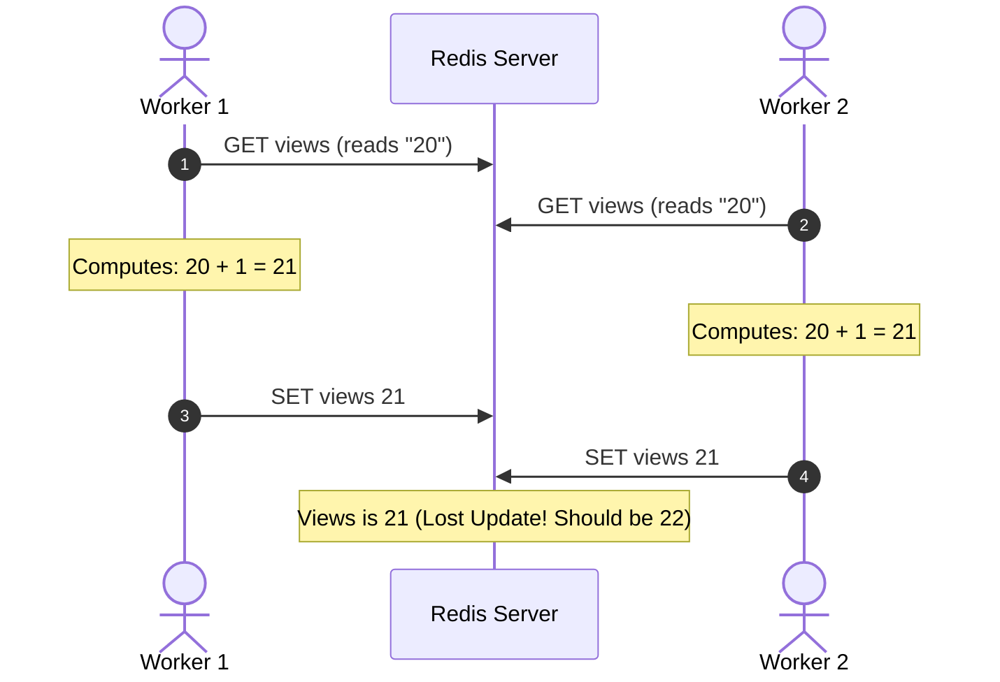
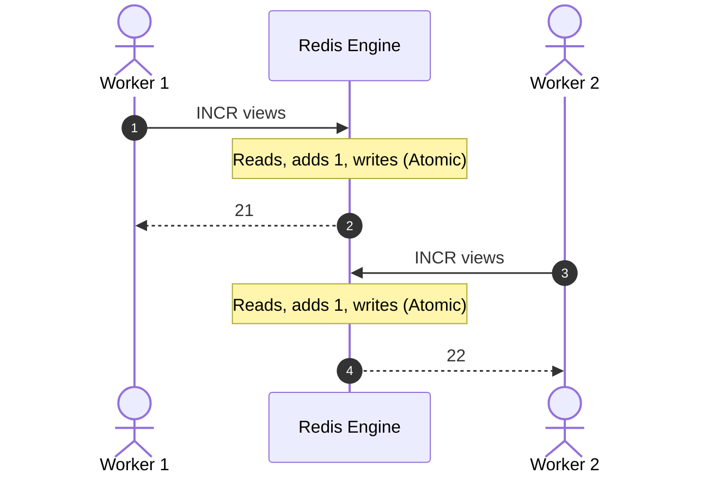

---

tags:

* redis
* commands
* strings
* numbers
* concurrency
* interview-prep
aliases:
* Redis Numbers and Counters
* Redis INCR and DECR
* Atomic Numeric Operations
date: 2026-10-04
module: "Redis Strings - Storing Numbers & Atomic Counters"

---

## 1. Overview

* Redis has **no dedicated "Number" data type** at the top level; numbers are stored as **Strings** (SDS) with integer or float semantics.
* Standard string commands (`SET`, `GET`, `MSET`, `MGET`) work identically with numeric values.
* Redis provides specialized arithmetic commands (`INCR`, `DECR`, `INCRBY`, `DECRBY`, `INCRBYFLOAT`) that temporarily parse the string, perform arithmetic, and save the updated value atomically.
* **Why they matter:** They execute inside Redis's single-threaded event loop, enabling atomic, lock-free operations that prevent race conditions common in distributed counters and rate limiters.

---

## 2. Key Concepts & Internal Representation

### The "String Under the Hood" Reality

When you execute:

```redis
SET age 20

```

1. Redis stores the value as a **string** representation (`"20"`).
2. When you retrieve it using `GET age`, Redis returns the Bulk String `"20"`.
3. The **application tier** is responsible for type conversion (e.g., `parseInt()` in JavaScript, `int()` in Python).

### Internal Optimization: `OBJ_ENCODING_INT`

Although exposed to clients as strings, Redis optimizes memory internally:

* If a string value can be parsed as a **64-bit signed integer**, Redis stores it internally as a long integer (`encoding: int`) rather than an SDS string.
* This saves memory pointers and makes subsequent math operations instantaneous.
* Verify internal encoding:

```redis
SET counter 100
OBJECT ENCODING counter
# Output: "int"

```

---

## 3. Command Reference & Signatures

```redis
# Increment by 1
INCR key

# Decrement by 1
DECR key

# Increment by a specific integer
INCRBY key increment

# Decrement by a specific integer
DECRBY key decrement

# Increment (or decrement via negative float) by a floating-point number
INCRBYFLOAT key increment

```

| Command | Argument Type | Step Size | Non-Existent Key Behavior | Time Complexity |
| --- | --- | --- | --- | --- |
| **`INCR`** | Integer | `+1` | Initializes key to `0`, then increments to `1` | $O(1)$ |
| **`DECR`** | Integer | `-1` | Initializes key to `0`, then decrements to `-1` | $O(1)$ |
| **`INCRBY`** | Integer | `+increment` | Initializes key to `0`, then adds increment | $O(1)$ |
| **`DECRBY`** | Integer | `-decrement` | Initializes key to `0`, then subtracts decrement | $O(1)$ |
| **`INCRBYFLOAT`** | Float | `±increment` | Initializes key to `0`, then adds float increment | $O(1)$ |

---

## 4. How It Works: Concurrency & Race Condition Elimination

The core architectural reason these commands exist is **atomicity**.

### The Problem: Read-Modify-Write Race Condition

In a standard application setup using `GET` and `SET`, two concurrent worker threads trying to increment a counter will overwrite each other:



### The Solution: Atomic `INCR` Execution

Because Redis executes commands sequentially in its single-threaded event loop, `INCR` eliminates the network lag between read and write:



---

## 5. Practical Examples

### 1. Integer Increments & Decrements

```redis
# Initialize age
SET age 20
# Output: OK

# Increment by 1
INCR age
# Output: (integer) 21

# Decrement by 1
DECR age
# Output: (integer) 20

# Add 20 in a single step
INCRBY age 20
# Output: (integer) 40

# Subtract 5
DECRBY age 5
# Output: (integer) 35

```

### 2. Floating-Point Arithmetic (`INCRBYFLOAT`)

```redis
# Initialize float counter
SET temperature 98.6

# Add positive float
INCRBYFLOAT temperature 1.5
# Output: "100.1"

# Decrement float using a negative value
INCRBYFLOAT temperature -3.3
# Output: "96.8"

```

*(Note: Redis has no standalone `DECRBYFLOAT`; pass a negative number to `INCRBYFLOAT` instead).*

### 3. Implicit Key Creation

```redis
# Ensure key does not exist
DEL new_counter

# Increment non-existent key
INCR new_counter
# Output: (integer) 1

# Verify value
GET new_counter
# Output: "1"

```

---

## 6. Edge Cases & Error Handling

### 1. Operating on Non-Numeric Strings

If a string key contains text that cannot be parsed as a 64-bit integer, Redis aborts the operation and returns an error:

```redis
SET message "hello"
INCR message

```

**Output:**

```
(error) ERR value is not an integer or out of range

```

### 2. 64-Bit Integer Boundary Limits

Redis integer commands operate strictly within signed 64-bit bounds:

* **Minimum Value:** $-2^{63} = -9,223,372,036,854,775,808$
* **Maximum Value:** $2^{63} - 1 = 9,223,372,036,854,775,807$

If an operation crosses these boundaries, Redis returns:

```
(error) ERR increment or decrement would overflow

```

---

## 7. Common Production Patterns

* **Real-Time Analytics & Counters:** Tracking page views, video play counts, API telemetry, and social media likes (`INCR post:101:views`).
* **Fixed-Window Rate Limiting:**
```redis
# Atomically initialize and increment request counter
INCR rate:ip_192_168_1_1
# Apply 60-second window on first request
EXPIRE rate:ip_192_168_1_1 60 NX

```


* **Distributed Auto-Increment IDs:** Generating sequential, collision-free transaction or ticket IDs across microservices without database sequences (`INCR order:id:seq`).
* **Inventory Depletion:** Using `DECRBY` to decrement available ticket or warehouse stock atomically without table locks.

---

## 8. Important Comparisons

| Pattern | Read-Modify-Write (`GET` + `SET`) | Redis Atomic Command (`INCRBY`) |
| --- | --- | --- |
| **Network RTT** | 2 Roundtrips (`GET`, then `SET`) | 1 Roundtrip |
| **Concurrency Safety** | Unsafe (requires distributed lock / `WATCH`) | 100% thread-safe (lock-free) |
| **Execution Speed** | Slower (application processing overhead) | Sub-microsecond (evaluated in RAM) |
| **Failure Modes** | High probability of race conditions | Zero risk of lost updates |

---

## 9. Interview Preparation

### Q1: How does Redis store numbers internally, and what happens when an application calls `GET` on a number?

**Answer:** Redis stores numbers as strings (specifically within an internal `redisObject` encoded as `int` if it fits within a 64-bit signed integer). When an application calls `GET`, Redis serializes the integer into a RESP bulk string (e.g., `"20"`). The application server's client library receives a string and must cast/parse it into a native language number.

### Q2: What happens if you run `INCR` on a key that does not exist?

**Answer:** Redis treats the non-existent key as having an initial value of `0`. It then executes the increment operation and sets the key's value to `1`, returning `(integer) 1`.

### Q3: Why is `INCR` preferred over fetching a value, incrementing it in application memory, and saving it back with `SET`?

**Answer:** The fetch-increment-save pattern is a non-atomic "check-then-act" sequence prone to lost updates under concurrent access (race conditions). `INCR` executes atomically within Redis's single-threaded event loop, guaranteeing strict serialization of math operations without requiring external distributed locks.

---

## 10. Quick Revision

* Redis has no native number type; numbers are **strings with numeric semantics**.
* Client applications receive string payloads from `GET` and must parse them into integers/floats.
* `INCR` / `DECR` step by `1`; `INCRBY` / `DECRBY` step by an explicit integer.
* `INCRBYFLOAT` supports floating-point steps; use negative floats to decrease.
* Missing keys default to `0` prior to running the arithmetic operation.
* Non-numeric strings fail immediately with `ERR value is not an integer or out of range`.
* Numeric commands are strictly **atomic** and prevent concurrency race conditions.