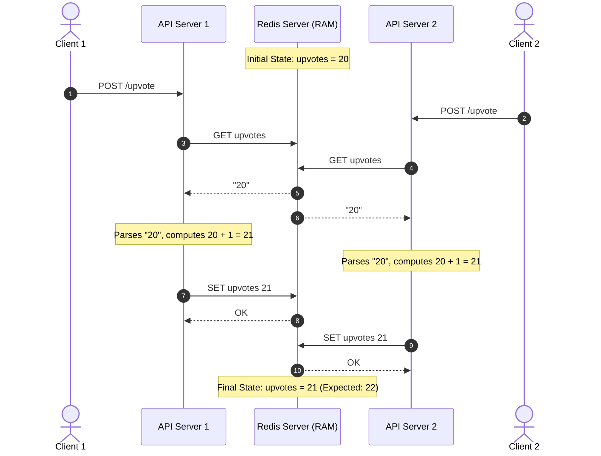
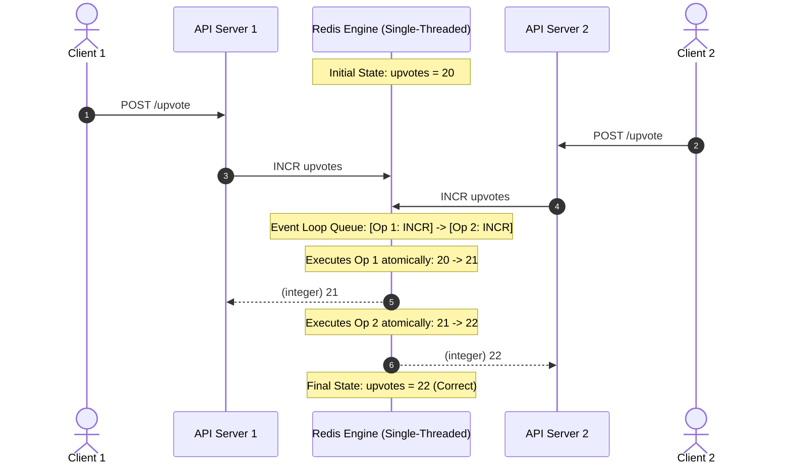

```markdown
---
tags:
  - redis
  - concurrency
  - race-conditions
  - atomicity
  - system-design
  - interview-prep
aliases:
  - Redis Concurrency and Atomicity
  - Why INCR Exists
  - Read-Modify-Write Race Condition
date: 2026-10-04
module: "Redis Concurrency - Race Conditions, Atomicity & Why INCR Exists"
---

## 1. Overview
- At first glance, dedicated arithmetic commands like `INCR` and `DECR` seem redundant because an application could theoretically implement them using basic `GET` and `SET` operations.
- Re-implementing counters via `GET` and `SET` introduces two critical architectural flaws:
  1. **Latency Overhead:** Requires two sequential network round-trips ($2 \times \text{RTT}$) rather than one.
  2. **Concurrency Hazards:** Under high throughput, concurrent application workers trigger **Read-Modify-Write race conditions**, causing lost updates.
- Dedicated numeric commands exist because they execute **atomically** inside Redis's single-threaded event loop, eliminating race conditions without the complexity of distributed locking.

---

## 2. Key Concepts & The Concurrency Trap

### The Read-Modify-Write Anti-Pattern
Consider an upvote counter on a high-traffic social platform (e.g., Reddit) initialized at `upvotes = 20`.

If an application increments this counter using separate commands:
1. Fetch the value (`GET upvotes`).
2. Deserialize/parse the string into an integer (`parseInt("20")`).
3. Compute the increment in application RAM (`20 + 1 = 21`).
4. Write the result back to Redis (`SET upvotes 21`).

When two independent API servers handle incoming requests concurrently, their operations interleave over the network.

---

## 3. How It Works: Visualizing the Race Condition

### Failure Scenario: Non-Atomic `GET` + `SET` (Lost Update)



**The Failure:** Both servers read `20`, independently compute `21`, and overwrite each other's updates. Despite two distinct user actions, the counter only increments by 1. One entire write is silently lost.

---

### Success Scenario: Atomic Execution via `INCR`



**The Resolution:** Redis is **synchronous and single-threaded** in its command execution engine. Even if both packets arrive over network cards at the identical microsecond, Redis enqueues them sequentially. Operation 1 completes fully before Operation 2 begins.

---

## 4. The Three Solutions to Redis Concurrency

When updating shared state across multiple application servers, there are three primary design patterns:

### Solution 1: Optimistic Locking (`WATCH` + `MULTI` / `EXEC`)

* Uses Redis transactions. The client marks a key with `WATCH upvotes`.
* The application executes `GET`, computes the new value, and enqueues `SET upvotes 21` inside a `MULTI` block.
* If another client modifies `upvotes` before `EXEC` runs, Redis aborts the transaction entirely, returning a null multi-bulk reply.
* **Trade-off:** High contention causes frequent transaction aborts and costly application-level retry loops.

### Solution 2: Distributed Locking (Mutex / Redlock)

* The application acquires an explicit distributed lock using `SET lock:upvotes token NX EX 5` before reading.
* Only the lock holder performs `GET`, increments locally, and calls `SET`.
* Once finished, the worker releases the lock.
* **Trade-off:** Heavy network overhead (acquiring, heartbeating, and releasing locks) and risk of deadlocks if timeouts are misconfigured.

### Solution 3: Native Atomic Primitive (`INCR` / `INCRBY`)

* Delegate both the read, mutation, and write entirely to the database engine in a single command.
* **Trade-off:** Fastest, lock-free, zero-retry mechanism. Best fit whenever business logic maps cleanly to native Redis arithmetic.

---

## 5. Practical Implementation Comparison

### Anti-Pattern: Non-Atomic Read-Modify-Write (Vulnerable to Race Conditions)

```javascript
// BAD: Prone to lost updates under high concurrency
async function upvotePostUnsafe(postId) {
  const currentVotes = await redis.get(`post:${postId}:upvotes`);
  const nextVotes = (parseInt(currentVotes) || 0) + 1;
  await redis.set(`post:${postId}:upvotes`, nextVotes);
  return nextVotes;
}

```

### Production Pattern: Native Atomic Increment (Thread-Safe & Lock-Free)

```javascript
// GOOD: Atomic, sub-millisecond, immune to race conditions
async function upvotePostAtomic(postId) {
  const nextVotes = await redis.incr(`post:${postId}:upvotes`);
  return nextVotes;
}

```

---

## 6. Important Comparisons

| Dimension | `GET` + `SET` (Naive) | `WATCH` + `MULTI` (Optimistic) | Distributed Lock (`SET NX`) | `INCR` / `INCRBY` (Native) |
| --- | --- | --- | --- | --- |
| **Network Roundtrips** | 2 RTT | 3–4 RTT + Retries | 3–5 RTT | **1 RTT** |
| **Concurrency Safety** | Unsafe (Lost Updates) | Safe (Aborts on conflict) | Safe (Mutual exclusion) | **Safe (Strict serialization)** |
| **Throughput / Latency** | Low / Variable | Low under high contention | Moderate | **Maximum / Sub-millisecond** |
| **Implementation Complexity** | Trivial | High (Requires retry loop) | High (Deadlock & lease handling) | **Minimal (Single line)** |
| **Resource Contention** | Corrupts data | Wastes CPU on failed retries | Locks out other threads | **Lock-free pipelining** |

---

## 7. Advantages and Limitations

### Advantages of Native Atomic Commands

* **Zero Race Conditions:** Commands run to completion within Redis's core execution loop before any other command on that key can execute.
* **Minimal Network Latency:** Eliminates the intermediate network trip where data sits in application memory.
* **Lock-Free Simplicity:** Eliminates deadlock hazards, lease expiration bugs, and retry backoff tuning.

### Limitations

* **Primitive Operations Only:** Native commands only handle basic addition, subtraction, or float math.
* **No Complex External Logic:** If updating a value depends on external REST API responses or complex multi-table validation, atomic commands alone are insufficient (requiring Lua scripts or explicit locking).

---

## 8. Interview Preparation

### Q1: "If Redis is single-threaded, how is it possible to have race conditions at all?"

**Answer:** Redis's command execution is single-threaded, meaning individual commands are strictly serialized and atomic. However, race conditions happen at the **application level** when multi-step workflows (like `GET` followed by `SET`) are separated by network hops. While Redis processes each `GET` and `SET` individually without memory corruption, concurrent client applications can interleave their reads and writes, resulting in stale reads and lost updates.

### Q2: What happens under high traffic when using optimistic locking (`WATCH`) vs. native `INCR`?

**Answer:** Under heavy write contention, optimistic locking degrades drastically because nearly every transaction fails its `WATCH` check, triggering repeated retry storms that consume CPU and network bandwidth. Native `INCR` handles arbitrary write contention gracefully because it queues and executes each increment sequentially in $O(1)$ time without aborting or retrying.

### Q3: When should an engineer use a Lua script or Distributed Lock instead of `INCR`?

**Answer:** Use `INCR` for simple counters, rate limiters, and sequential IDs. Use **Lua scripts** when multiple conditional checks across different data structures must execute atomically (e.g., *deduct inventory only if balance > 0 and user is active*). Use a **Distributed Lock** when the operation involves non-Redis side effects, such as calling an external third-party payment gateway or interacting with a slow file system.

---

## 9. Quick Revision

* Replicating `INCR` with `GET` + `SET` creates a **Read-Modify-Write race condition**.
* Two concurrent workers executing `GET` + `SET` on a value of `20` will both write `21`, losing one update.
* Redis prevents race conditions for counters because its core execution engine is **single-threaded and synchronous**.
* Atomic commands reduce network round-trips from $2\times\text{RTT}$ to $1\times\text{RTT}$.
* The 3 ways to solve Redis concurrency:
1. **Native Atomic Commands** (`INCR`, `HINCRBY`) $\rightarrow$ Preferred whenever possible.
2. **Optimistic Locking** (`WATCH` / `MULTI`) $\rightarrow$ Multi-step Redis-only conditional logic.
3. **Distributed Locking** (`SET ... NX EX`) $\rightarrow$ Multi-system workflows involving third-party APIs or SQL databases.
