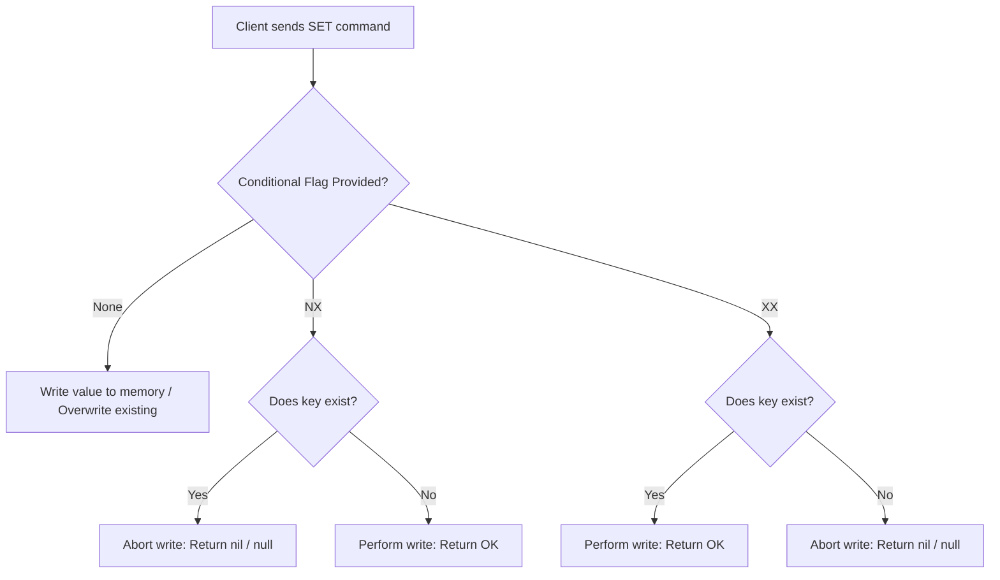

---
tags:
  - redis
  - commands
  - strings
  - concurrency
  - interview-prep
aliases:
  - Redis SET Command Deep Dive
  - Redis SET Options and Modifiers
date: 2026-10-04
module: "Redis Strings - Deep Dive on the SET Command"
---

## 1. Overview
- The `SET` command is the foundational write operation for Redis Strings[cite: 7, 8].
- In modern Redis, `SET` serves as a versatile atomic primitive through optional modifiers that handle expiration, conditional existence checks, and atomic value swapping[cite: 8].
- It eliminates the need for separate, error-prone multi-command transactions in patterns like distributed locking and cache updates[cite: 8, 10].

---

## 2. Key Concepts

### Full Command Signature
```redis
SET key value [EX seconds | PX milliseconds | EXAT unix-time-seconds | PXAT unix-time-milliseconds | KEEPTTL] [NX | XX] [GET]
```
[cite: 6, 7]

### Documentation Syntax Breakdown
- **Capitalized Words**: Literal keywords that must be provided exactly as written (e.g., `SET`, `EX`, `NX`)[cite: 7].
- **Lowercase Words**: User-provided arguments, keys, or values (e.g., `key`, `value`)[cite: 7, 8].
- **Square Brackets `[...]`**: Optional arguments that can be omitted[cite: 7].
- **Vertical Pipe `|`**: Mutually exclusive options representing "OR"[cite: 7].
- **`key`**: The unique identifier where data is stored[cite: 8].
- **`value`**: The string payload stored at that address (up to 512 MB)[cite: 8].
- **Expiration Options**: Defines when the key will automatically be removed from memory[cite: 8].
- **Condition Modifiers (`NX` | `XX`)**: Controls whether the command writes based on key presence[cite: 8].
- **Return Previous Value (`GET`)**: Instructs Redis to return the existing value while applying the new one[cite: 8].

---

## 3. How It Works

### Execution Workflow



### 1. Conditional Modifiers (`NX` vs. `XX`)
- **`NX` ("Not eXists")**: Executes the write operation only if the key does not already exist in Redis[cite: 8, 10]. If the key exists, the write is aborted and Redis returns `(nil)` (null)[cite: 10].
- **`XX` ("eXists")**: Executes the write operation only if the key already exists[cite: 8, 9]. If the key does not exist, the write is aborted and Redis returns `(nil)` (null)[cite: 9].

### 2. Atomic Value Swapping (`GET`)
- When `GET` is appended, `SET` returns the previous string value stored at the key instead of the default string `OK`[cite: 8].
- If the key did not exist before execution, Redis returns `(nil)`[cite: 8].

### 3. Expiration Modifiers (TTL)
- **`EX seconds`**: Sets an auto-expiry time in whole seconds[cite: 7, 8].
- **`PX milliseconds`**: Sets an auto-expiry time in milliseconds[cite: 7, 8].
- **`EXAT unix-time-seconds`**: Sets an absolute Unix timestamp (in seconds) for key expiration[cite: 7, 8].
- **`PXAT unix-time-milliseconds`**: Sets an absolute Unix timestamp (in milliseconds) for key expiration[cite: 7, 8].
- **`KEEPTTL`**: Retains the remaining time-to-live previously associated with the key[cite: 7, 8].

---

## 4. Practical Examples

### Conditional Writes (`NX` and `XX`)
```redis
# 1. Successful initialization with NX (key does not exist)
SET user:status "active" NX
# Output: OK

# 2. Failed write with NX (key already exists)
SET user:status "suspended" NX
# Output: (nil)

# 3. Successful update with XX (key exists)
SET user:status "archived" XX
# Output: OK

# 4. Failed update with XX on non-existent key
SET non_existent_key "temp" XX
# Output: (nil)
```

### Atomic Swapping with `GET`
```redis
# Initialize value
SET config:rate_limit "100"
# Output: OK

# Update to 200 and retrieve previous setting atomically
SET config:rate_limit "200" GET
# Output: "100"
```

---

## 5. Important Comparisons

| Pattern / Flag | Behavior | Modern Syntax | Legacy Predecessor | Status |
| :--- | :--- | :--- | :--- | :--- |
| **Write if absent** | Write only if key does not exist[cite: 8, 10] | `SET key val NX`[cite: 10] | `SETNX key val` | Legacy command superseded |
| **Write if present** | Write only if key exists[cite: 8, 9] | `SET key val XX`[cite: 9] | None (Required Lua script / WATCH) | Modern native standard |
| **Write with TTL** | Write and assign automatic expiry[cite: 8] | `SET key val EX <sec>`[cite: 7, 8] | `SETEX key <sec> val` | Legacy command superseded |
| **Swap & Return** | Write new value and return previous value[cite: 8] | `SET key val GET`[cite: 8] | `GETSET key val` | Deprecated in Redis 6.2 |

> [!TIP] Production Best Practice
> Avoid standalone commands like `SETNX`, `SETEX`, and `GETSET`. The modern `SET` command consolidates all options into a single, composable API (e.g., combining `NX` with `EX`)[cite: 7, 8].

---

## 6. When to Use

- **Distributed Locks (Mutex)**: Use `SET resource_id token NX EX seconds` to ensure only one worker holds the lock, while guaranteeing auto-release if the worker crashes[cite: 8, 10].
- **Cache Refreshing with `XX`**: Use `XX` to update existing cache entries without accidentally creating orphan keys[cite: 8, 9].
- **Preserving Expirations with `KEEPTTL`**: Update the value of an active cache entry without resetting its active expiration timer[cite: 7, 8].
- **Atomic Counters & State Transition**: Use `GET` to swap configurations or active states without an extra read network roundtrip[cite: 8].

---

## 7. Advantages and Limitations

### Advantages
- **Atomicity**: Parameter evaluation, condition checks, and TTL assignment occur atomically within Redis's single-threaded execution model.
- **Network Optimization**: Combines write, expiration, and read operations into a single roundtrip time (RTT)[cite: 8].

### Limitations
- **Single-Key Scope**: Cannot evaluate conditions across multiple distinct keys atomically.
- **Payload Constraint**: The value stored cannot exceed 512 MB.

---

## 8. Additional Knowledge

- **Return Types**:
  - Without `GET`: Returns `+OK` (Simple String) on success, or `$-1` (`(nil)`) when an `NX` or `XX` condition fails[cite: 9, 10].
  - With `GET`: Returns the previous value as a Bulk String[cite: 8], or `(nil)` if no value previously existed.
- **Race Condition Elimination**: Running `SET ... NX EX` prevents the critical race condition of setting a key with `SETNX` and crashing before calling `EXPIRE`.

---

## 9. Interview Preparation

### Q1: Why should you use `SET key value NX EX seconds` instead of calling `SETNX` followed by `EXPIRE`?
**Answer:** Calling `SETNX` and `EXPIRE` separately is non-atomic. If the application or Redis crashes between the two commands, the key remains without an expiration deadline, leading to permanent deadlocks. `SET ... NX EX` evaluates the existence check and sets the TTL atomically in a single operation[cite: 8, 10].

### Q2: What happens if you run `SET count 50 KEEPTTL` on a key that currently has no TTL?
**Answer:** The value updates to `50` and the key remains persistent without an expiration time attached[cite: 7, 8].

### Q3: What does a `(nil)` response indicate when executing a `SET` command?
**Answer:** It indicates that the conditional write failed—either `NX` was passed and the key already existed[cite: 10], or `XX` was passed and the key was absent[cite: 9].

---

## 10. Quick Revision

- `SET key value` is the standard string write command[cite: 7, 8].
- `NX` = Set only if Not eXists (ideal for distributed lock acquisition)[cite: 8, 10].
- `XX` = Set only if eXists (ideal for safe updates to existing records)[cite: 8, 9].
- `GET` = Returns the previous value while applying the update (atomic swap)[cite: 8].
- `EX` / `PX` = Relative time-to-live in seconds or milliseconds[cite: 7, 8].
- `KEEPTTL` = Overwrites the value while maintaining the remaining TTL intact[cite: 7, 8].