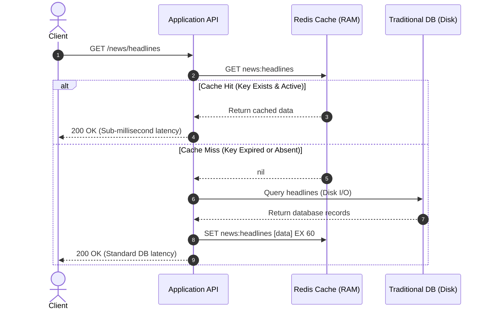

---

tags:

* redis
* caching
* ttl
* architecture
* interview-prep
aliases:
* Redis Key Expiration
* Cache-Aside Pattern
* Redis TTL Mechanics
date: 2026-10-04
module: "Redis Strings - Expiration (TTL) & Caching Architecture"

---

## 1. Overview

* Redis was originally designed primarily as an in-memory caching engine to deliver high throughput and sub-millisecond response times.
* Because system memory (RAM) is finite and substantially more expensive than persistent disk storage, storing datasets indefinitely leads to out-of-memory (OOM) failures.
* Redis provides **automatic key expiration (Time-To-Live / TTL)** to delete keys automatically after a specified duration or timestamp.
* Automatic expiration solves two major engineering problems:
* **Memory Reclamation**: Automatically frees memory by pruning transient or inactive keys.
* **Cache Freshness**: Enforces a maximum age on cached records so stale data is replaced by fresh reads from the primary database.


---

## 2. Key Concepts

### Expiration Modifiers for `SET`

```redis
SET key value [EX seconds | PX milliseconds | EXAT unix-time-seconds | PXAT unix-time-milliseconds | KEEPTTL]

```

* **`EX seconds`**: Sets an auto-expiry deadline in whole seconds (relative duration).
* **`PX milliseconds`**: Sets an auto-expiry deadline in milliseconds (relative duration).
* **`EXAT unix-time-seconds`**: Sets an absolute expiration timestamp using Unix epoch time in seconds.
* **`PXAT unix-time-milliseconds`**: Sets an absolute expiration timestamp using Unix epoch time in milliseconds.
* **`KEEPTTL`**: Retains the remaining time-to-live previously associated with the key when updating its value.

### Dedicated TTL Inspection & Management Commands

* **`TTL key`**: Inspects remaining time-to-live in seconds.
* Positive integer: Number of seconds remaining until deletion.
* `-1`: The key exists and is persistent (no expiration assigned).
* `-2`: The key does not exist (or has already expired and been removed).


* **`PTTL key`**: Inspects remaining lifetime in milliseconds.
* **`EXPIRE key seconds`**: Sets or updates a TTL on an existing persistent key.
* **`PERSIST key`**: Clears the expiration timer, making the key permanently resident in RAM.

---

## 3. How It Works

### The Cache-Aside (Lazy Loading) Architecture

In web architectures, Redis operates alongside disk-based databases (e.g., PostgreSQL, MySQL) using the **Cache-Aside Pattern**:



### Execution Lifecycle

1. **Cache Query**: The application issues a `GET` command to Redis.
2. **Cache Hit**: If data is present, Redis returns the payload immediately with sub-millisecond response time; the primary database is never touched.
3. **Cache Miss**: If the key has expired or was never created, Redis returns `(nil)`.
4. **Primary Database Query**: The application falls back to querying the persistent disk-based database.
5. **Cache Population**: The application writes the fresh data into Redis along with an expiration parameter (e.g., `EX 60`).
6. **Subsequent Reads**: Subsequent user requests are served directly from RAM until the TTL expires.

---

## 4. Practical Examples

### Basic Expiration in Action

```redis
# 1. Set key with an automatic 2-second expiration
SET color "red" EX 2
# Output: OK

# 2. Immediate read within 2 seconds (Cache Hit)
GET color
# Output: "red"

# 3. Read after waiting 2+ seconds (Cache Miss / Expired)
GET color
# Output: (nil)

```

### Managing Active Key Lifecycles

```redis
# 1. Create a persistent key
SET session:user_99 "active_session"
# Output: OK

# 2. Check TTL (-1 confirms key is persistent)
TTL session:user_99
# Output: (integer) -1

# 3. Dynamically assign a 300-second expiration
EXPIRE session:user_99 300
# Output: (integer) 1

# 4. Check remaining lifespan
TTL session:user_99
# Output: (integer) 296

# 5. Overwrite the value while preserving the active timer
SET session:user_99 "updated_session" KEEPTTL
# Output: OK

# 6. Remove expiration entirely to make the key permanent
PERSIST session:user_99
# Output: (integer) 1

```

---

## 5. Important Comparisons

### Expiration Options Matrix

| Option | Unit / Format | Reference Type | Common Use Case |
| --- | --- | --- | --- |
| **`EX`** | Seconds | Relative duration | General API caching, session storage, token expiry. |
| **`PX`** | Milliseconds | Relative duration | Short-lived locks, sliding windows, micro-benchmarks. |
| **`EXAT`** | Unix Epoch (Seconds) | Absolute timestamp | Scheduled daily cutoffs (e.g., midnight UTC resets). |
| **`PXAT`** | Unix Epoch (Milliseconds) | Absolute timestamp | Coordinated real-time auction/bidding deadlines. |
| **`KEEPTTL`** | N/A | State flag | Updating record values without extending session timeouts. |

### Redis In-Memory Cache vs. Traditional Database

| Feature | In-Memory Cache (Redis) | Primary Database (PostgreSQL / MySQL) |
| --- | --- | --- |
| **Storage Medium** | System RAM | Persistent NVMe / SSD disk storage |
| **Data Lifespan** | Ephemeral / TTL-managed | Persistent long-term storage |
| **Latency Profile** | Sub-millisecond (< 1 ms) | Low-millisecond (5 to 50 ms) |
| **Primary Role** | Read-heavy acceleration, temporary state | Source of truth, transactional ACID consistency |
| **Data Loss Impact** | Low (can re-fetch from primary database) | High (data loss directly impacts business operations) |

---

## 6. When to Use

* **High-Throughput API Caching**: Offloading repeated read operations and expensive SQL joins from primary databases.
* **Session Management**: Automatically expiring user sessions and authentication tokens after periods of inactivity.
* **API Rate Limiting**: Implementing fixed-window rate limits (e.g., create key with `EX 60` and increment on each request).
* **Auto-Releasing Distributed Locks**: Using `SET lock_resource token NX EX 10` so crashed worker nodes do not hold mutexes indefinitely.

---

## 7. Advantages and Limitations

### Advantages

* **Autonomous Cleanup**: Redis handles deallocation internally without requiring application-side cleanup scripts or cron jobs.
* **Memory Footprint Control**: Eliminates infinite memory growth caused by orphaned or outdated keys.
* **Prevents Stale Data**: Enforces a bounded window on cached copies of application data.

### Limitations

* **Eventual Consistency Lag**: If database records change before a TTL expires, clients will read outdated cache data until the key reaches its deadline.
* **Cache Miss Penalties**: Simultaneous key expirations force subsequent requests to query the slower persistent database.

---

## 8. Additional Knowledge (System Internals & Hazards)

### How Redis Deletes Expired Keys Under the Hood

Redis does not attach a dedicated OS timer or background thread to every individual key. Instead, it uses a hybrid mechanism:

1. **Passive (Lazy) Expiration**:
* When a client issues a command on a key (e.g., `GET key`), Redis checks its internal timestamp metadata.
* If expired, Redis frees the key immediately and returns `(nil)`.


2. **Active (Periodic) Expiration**:
* 10 times per second (every 100 ms), Redis runs a background routine that samples 20 random keys with active TTLs.
* All expired keys in that sample are deleted.
* If more than 25% of the sampled keys are expired, Redis immediately repeats the process to reclaim RAM without waiting for client requests.


### Critical Production Hazards

> [!WARNING] Cache Avalanche
> **Problem**: Assigning the exact same TTL (e.g., `EX 3600`) to thousands of keys causes them all to expire simultaneously, sending a sudden traffic surge directly to the primary database.
> **Solution**: Add random jitter to your TTL values:
> TTL = base_seconds + random_jitter(0, 300)

> [!WARNING] Cache Breakdown (Hotspot Key Invalidation)
> **Problem**: A heavily-accessed "hot key" expires, causing hundreds of concurrent requests to experience a cache miss at the exact same moment and overload the primary database.
> **Solution**: Use a distributed mutex lock (`SET lock:key token NX EX 5`) so only one thread recomputes the cache while all other incoming requests wait.

---

## 9. Interview Preparation

### Q1: What is the difference between `EX` and `EXAT`?

**Answer:** `EX` configures a relative duration in seconds starting from the moment of execution. `EXAT` takes an absolute Unix epoch timestamp in seconds, ensuring synchronized expiration across distributed nodes regardless of network transit delays.

### Q2: What happens if you run `SET key new_val` on a key that already has a TTL, without passing an expiration modifier?

**Answer:** The existing TTL is cleared, and the key becomes permanent. To update the payload while preserving an existing TTL, you must explicitly include the `KEEPTTL` modifier.

### Q3: How does Redis prevent memory from filling up with expired keys that are never read again?

**Answer:** Through active periodic expiration. Ten times per second, Redis randomly samples keys that have TTLs, evicts expired ones, and repeats the cycle if more than 25% of the sample has expired, preventing unread keys from leaking RAM.

---

## 10. Quick Revision

* `EX` sets relative expiration in **seconds**; `PX` sets relative expiration in **milliseconds**.
* `EXAT` and `PXAT` set absolute expiration deadlines using **Unix timestamps**.
* `KEEPTTL` preserves existing key expiration timers across value updates.
* `TTL key` inspects remaining lifespan (`-1` = persistent key, `-2` = non-existent or expired).
* The **Cache-Aside Pattern** checks Redis first, queries the database on a miss, and re-populates Redis with an explicit TTL.
* Key cleanup relies on a hybrid model: **Passive (on read)** + **Active (periodic 10Hz sampling)**.