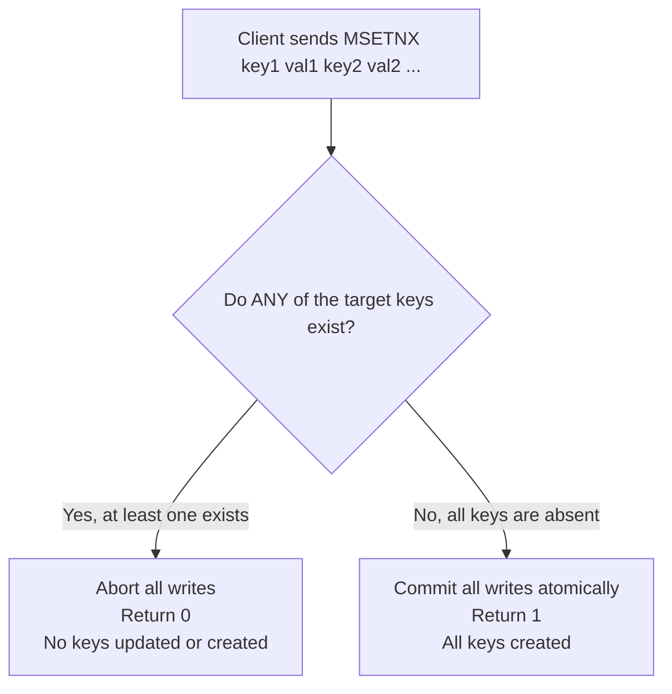

---

tags:

* redis
* commands
* strings
* batch-operations
* concurrency
* interview-prep
aliases:
* Redis SETNX and SETEX
* Redis MSET and MSETNX
* Batch and Conditional String Commands
date: 2026-10-04
module: "Redis Strings - Legacy Conditionals & Batch Operations"

---

## 1. Overview

* Redis provides specialized string commands for conditional writes (`SETNX`), expiration writes (`SETEX`), and multi-key batch operations (`MSET`, `MSETNX`).
* While `SETNX` and `SETEX` are widely seen in older codebases and documentation, modern Redis implementations replace them with extended options on the unified `SET` command.
* `MSET` and `MSETNX` provide atomic batch processing, eliminating network latency by consolidating multiple independent write operations into a single roundtrip.

---

## 2. Key Concepts

### Command Signatures & Mechanics

```redis
# Legacy conditional and expiration commands
SETNX key value
SETEX key seconds value

# Batch string operations
MSET key value [key value ...]
MSETNX key value [key value ...]

```

* **`SETNX` ("Set if Not eXists")**: Sets the key to hold the given string only if the key does not already exist.
* **`SETEX` ("Set with Expiration")**: Atomically sets the key to hold the value and configures an expiration deadline in seconds.
* **`MSET` ("Multiple Set")**: Atomically sets multiple key-value pairs in a single operation. Overwrites any existing keys.
* **`MSETNX` ("Multiple Set if Not eXists")**: Atomically sets multiple key-value pairs **only if none** of the specified keys already exist.

---

## 3. How It Works

### 1. `MSET` Execution Flow

* `MSET` processes an arbitrary list of key-value tuples sequentially in memory during a single event loop cycle.
* The command is **atomic**: no other client can view a partial update where some keys are updated while others are pending.

### 2. `MSETNX` All-or-Nothing Decision Flow



* Before applying any writes, Redis checks the entire keyspace for all specified keys.
* If even a single key is already present, the entire operation is rejected. There is no partial success.

---

## 4. Practical Examples

### Working with `SETEX` and `SETNX` (Legacy Patterns)

```redis
# 1. Set key with a 2-second expiration
SETEX cache:temp_code 2 "948201"
# Output: OK

# 2. Attempt conditional set on non-existent key
SETNX user:lock "process_1"
# Output: (integer) 1   <-- 1 indicates write succeeded

# 3. Attempt conditional set on already existing key
SETNX user:lock "process_2"
# Output: (integer) 0   <-- 0 indicates key existed; write skipped

```

### Batch Writes with `MSET`

```redis
# Set multiple attributes in a single network roundtrip
MSET vehicle:color "red" vehicle:brand "Toyota" vehicle:year "2024"
# Output: OK

# Retrieve values to verify
MGET vehicle:color vehicle:brand vehicle:year
# Output:
# 1) "red"
# 2) "Toyota"
# 3) "2024"

```

### Atomic Batch Verification with `MSETNX`

```redis
# 1. Initial batch set (both keys are brand new)
MSETNX config:port "8080" config:host "127.0.0.1"
# Output: (integer) 1   <-- Both keys written successfully

# 2. Subsequent batch where one key already exists (config:port exists, config:timeout is new)
MSETNX config:port "9090" config:timeout "30"
# Output: (integer) 0   <-- Operation aborted!

# 3. Verify that config:timeout was NOT written
EXISTS config:timeout
# Output: (integer) 0

```

---

## 5. Important Comparisons

### Legacy vs. Modern Command Equivalence

| Legacy Command | Modern Standard Syntax | Status | Return Value Difference |
| --- | --- | --- | --- |
| **`SETNX key val`** | `SET key val NX` | Deprecated / Legacy | `SETNX` returns integer (`1` or `0`); `SET ... NX` returns `OK` or `(nil)`. |
| **`SETEX key sec val`** | `SET key val EX sec` | Deprecated / Legacy | Both return `OK`, but the argument order is inverted. |

> [!WARNING] The Argument Order Trap
> In `SETEX`, the timeout comes **before** the value: `SETEX key seconds value`.
> In modern `SET`, the value comes **before** the flag: `SET key value EX seconds`.
> Mixing up these command signatures in production scripts is a common source of runtime bugs.

### `MSET` vs. `MSETNX`

| Feature | `MSET` | `MSETNX` |
| --- | --- | --- |
| **Overwrite Behavior** | Overwrites existing keys unconditionally | Rejects entire command if even one key exists |
| **Atomicity** | Atomic across all writes | Atomic all-or-nothing check and write |
| **Return Value** | Always `OK` | `1` if all keys set; `0` if no keys set |
| **Primary Use Case** | Bulk cache hydration / database seeding | Multi-variable lock acquisition / initialization |

---

## 6. When to Use

* **`MSET` for Bulk Cache Hydration:** Use when initializing or refreshing multiple related cache keys at application startup to eliminate network Round Trip Time (RTT).
* **`MSETNX` for Coordinated Resource Allocation:** Use when multiple interdependent resources must be claimed together (e.g., claiming two distinct resource locks simultaneously where taking only one would cause a deadlock).
* **Modern `SET ... NX` / `EX` over Legacy Forms:** Always default to `SET key val [NX] [EX sec]` in new applications to keep code uniform and compatible with future Redis releases.

---

## 7. Advantages and Limitations

### Advantages

* **Reduced Network Latency (RTT):** `MSET` executes $N$ writes over a single TCP request/response lifecycle instead of $N$ sequential network roundtrips.
* **Strict Atomicity:** Both `MSET` and `MSETNX` prevent race conditions where intermediate states are visible to concurrent connections.

### Limitations

* **No Individual TTL Support:** `MSET` cannot assign expiration deadlines (TTLs) to individual keys within the batch. Setting TTLs requires subsequent `EXPIRE` calls or a Lua script.
* **Single-Threaded Head-of-Line Blocking:** Running `MSET` with thousands of keys in a single call blocks the Redis event loop until all keys are written.

---

## 8. Additional Knowledge (System Internals & Clustering)

### The Redis Cluster `CROSSSLOT` Constraint

In distributed Redis (Redis Cluster), the entire keyspace is divided into **16,384 hash slots**. Multi-key commands (`MSET`, `MGET`, `MSETNX`) require all keys in the command to resolve to the **same hash slot**.

```redis
# In Redis Cluster, if key1 and key2 map to different nodes/slots:
MSET user:100:name "Alice" user:200:name "Bob"
# Output: (error) CROSSSLOT Keys in request don't hash to the same slot

```

#### The Hash Tag Solution `{...}`

To execute multi-key operations safely in a clustered environment, wrap the common routing key in curly braces so Redis hashes only the bracketed text:

```redis
# Both keys hash strictly using "user:100", guaranteeing placement on the same node
MSET {user:100}:name "Alice" {user:100}:email "alice@example.com"
# Output: OK

```

---

## 9. Interview Preparation

### Q1: Why is `MSET` preferred over sending multiple sequential `SET` commands in an application loop?

**Answer:** Network round-trip time (RTT) is typically the primary bottleneck in Redis operations. Sending ten `SET` commands sequentially requires ten network roundtrips. `MSET` packages all ten writes into a single network packet, executing them atomically within the single-threaded event loop and returning a single response.

### Q2: If `MSETNX` is called with 5 keys and 4 do not exist, but 1 does exist, what happens?

**Answer:** Redis performs an all-or-nothing check. Because one key exists, the entire operation is aborted. None of the other 4 keys are created or modified, and Redis returns integer `0`.

### Q3: What is the main design reason for deprecating `SETNX` and `SETEX` in favor of extended `SET` flags?

**Answer:** The standalone commands were redundant and non-composable. You could not cleanly combine behavior (for instance, "set if not exists" with a TTL required awkward script workarounds or `SETNX` + `EXPIRE` race conditions). The unified `SET key value [NX|XX] [EX|PX]` allows composable atomic parameters in a single API standard.

---

## 10. Quick Revision

* `SETNX` = Set if Not eXists (legacy; prefer `SET key val NX`).
* `SETEX` = Set with Expiration (legacy; prefer `SET key val EX sec`).
* Remember syntax differences: `SETEX` puts seconds **before** value; `SET` puts value **before** `EX`.
* `MSET key1 val1 key2 val2 ...` = Atomic bulk write; always returns `OK`.
* `MSETNX key1 val1 key2 val2 ...` = Atomic bulk write only if **all** keys are absent; returns `1` (success) or `0` (aborted).
* Multi-key commands in Redis Cluster cause `CROSSSLOT` errors unless grouped using `{hash_tags}`.